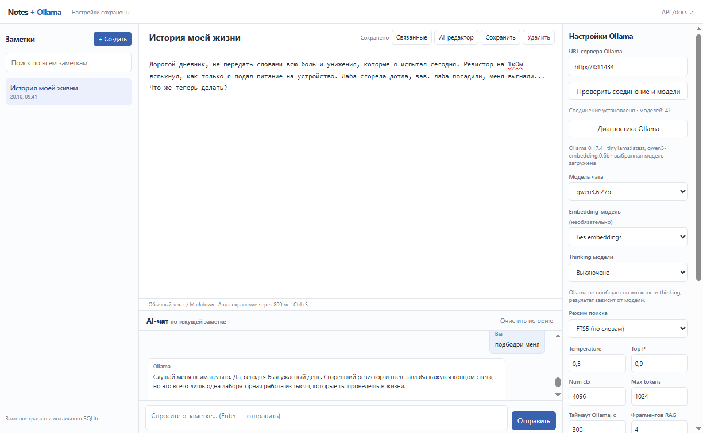

# Notes + Ollama

Локальное веб-приложение для заметок с редактором, поиском и чат-ассистентом на базе [Ollama](https://ollama.com/). Интерфейс работает в браузере, сервер написан на **FastAPI**, а данные хранятся в **SQLite**. Фронтенд реализован на HTML, CSS и JavaScript без дополнительных фреймворков.



## Возможности

- **Заметки:** создание, редактирование, удаление, поиск по заголовкам и содержимому; автосохранение и `Ctrl+S`.
- **Чат по заметке:** вопросы к выбранному тексту с учётом истории диалога; режим запроса без истории.
- **Потоковые ответы:** текст появляется по мере генерации через Server-Sent Events (SSE); доступны таймер, стадии запроса и статистика Ollama.
- **AI-редактор:** предлагает новую редакцию заметки по инструкции. Изменения применяются только после подтверждения.
- **Поиск по базе:** полнотекстовый индекс SQLite FTS5. Опционально — гибридный поиск с embeddings через Ollama.
- **Настройки модели:** адрес сервера, выбор установленной модели, системный промпт, temperature, top_p, контекст, лимит токенов и thinking (если модель поддерживает).
- **Диагностика:** проверка Ollama, журнал стадий генерации, `request_id`, режим подробного логирования.

Приложение рассчитано на локальное использование одним пользователем. Регистрация и авторизация не предусмотрены.

## Требования

- Python **3.11+**.
- Доступный сервер Ollama — локальный или удалённый (нужен для функций с моделью).
- SQLite с поддержкой **FTS5** (обычно включён в стандартные сборки Python).

Заметки, обычный текстовый поиск и интерфейс доступны **без запущенной Ollama**.

## Установка и запуск

Склонируйте репозиторий и откройте его каталог:

```bash
git clone https://github.com/USERNAME/REPOSITORY.git
cd REPOSITORY
```

Замените `USERNAME/REPOSITORY` адресом своего репозитория. Также можно скачать ZIP с GitHub и распаковать его.

Создайте виртуальное окружение и установите зависимости.

**Linux / macOS / Windows Git Bash:**

```bash
python -m venv .venv
# Linux / macOS:
source .venv/bin/activate
# Windows Git Bash:
# source .venv/Scripts/activate
python -m pip install -r requirements.txt
```

**Windows PowerShell:**

```powershell
py -m venv .venv
.\.venv\Scripts\Activate.ps1
python -m pip install -r requirements.txt
```

Запустите сервер:

```bash
uvicorn app.main:app --reload
```

Откройте **http://127.0.0.1:8000**. Интерактивная документация API доступна на **http://127.0.0.1:8000/docs**.

> `--reload` предназначен для разработки. Приложение не следует публиковать в открытом интернете без отдельной аутентификации, HTTPS и ограничения доступа к API.

## Подключение Ollama

1. Установите [Ollama](https://ollama.com/download) на компьютер или сервер, на котором будут запускаться модели.
2. Загрузите чат-модель, например:

   ```bash
   ollama pull qwen2.5:3b
   ```

3. В правой панели укажите URL сервера (по умолчанию `http://127.0.0.1:11434`).
4. Нажмите **«Проверить соединение и модели»**, выберите модель чата и сохраните настройки.
5. При необходимости настройте системный промпт и параметры генерации.

Для семантического поиска дополнительно загрузите embedding-модель:

```bash
ollama pull nomic-embed-text
```

Затем выберите её в приложении, переключите поиск в режим **«Гибридный (FTS + embeddings)»** и выполните индексацию. Если Ollama расположена на другом компьютере, устанавливать модели нужно **на нём**, а не на компьютере с браузером.

Thinking зависит от конкретной модели и версии Ollama. Не все модели поддерживают его отключение или уровни детализации.

## Конфигурация

Настройки Ollama и параметры приложения редактируются в правой панели и сохраняются в SQLite. Дополнительные параметры процесса задаются **переменными окружения**:

| Переменная | Значение | По умолчанию |
| --- | --- | --- |
| `NOTES_DB_PATH` | Путь к файлу SQLite | `data/notes.db` |
| `NOTES_LOG_LEVEL` | Уровень логирования (`DEBUG`, `INFO`, `WARNING`, `ERROR`) | `INFO` |
| `NOTES_LOG_PREVIEW` | Показывать фрагменты некорректных ответов Ollama (`0`/`1`) | `0` |

Образец находится в [`.env.example`](.env.example). Он приведён для справки: `.env` **не загружается автоматически**, переменные нужно экспортировать перед запуском.

Для подробного журнала в Git Bash / Linux / macOS:

```bash
export NOTES_LOG_LEVEL=DEBUG
uvicorn app.main:app --reload
```

Для PowerShell:

```powershell
$env:NOTES_LOG_LEVEL = "DEBUG"
uvicorn app.main:app --reload
```

Каждый запрос получает `request_id`, который используется в логах, HTTP-заголовке `X-Request-ID` и событиях потока. Это помогает сопоставить действия браузера, FastAPI и Ollama.

> Включайте `NOTES_LOG_PREVIEW=1` только при локальной диагностике: в логи могут попадать части ответов модели и личных заметок. Не публикуйте такие логи без проверки.

## Структура проекта

```text
app/
  api/             HTTP API: заметки, чат, настройки
  services/        Работа с заметками, Ollama, поиском и контекстом
  static/          HTML, CSS, JavaScript
  database.py      SQLite, создание таблиц и FTS5
  diagnostics.py   Логирование и request_id
  schemas.py       Pydantic-схемы запросов и настроек
  main.py          FastAPI, middleware и раздача интерфейса
tests/             Тесты API и сервиса Ollama
tools/             Прямая диагностика Ollama
  ollama_probe.py
docs/images/       Скриншот интерфейса
data/              Локальная база SQLite (не включается в Git)
```

Схема взаимодействия: браузер обращается к API FastAPI; сервер читает заметки из SQLite, собирает контекст, запрашивает Ollama через `httpx` и возвращает поток событий через SSE. Индексация embeddings запускается в фоновой задаче FastAPI. Для небольших локальных баз отдельная векторная СУБД не нужна.

## API

Основные маршруты (полная схема доступна в `/docs`):

| Метод | Маршрут | Назначение |
| --- | --- | --- |
| `GET` | `/api/notes` | Список заметок |
| `POST` | `/api/notes` | Создать заметку |
| `GET` | `/api/notes/{id}` | Получить заметку |
| `PUT` | `/api/notes/{id}` | Изменить заметку |
| `DELETE` | `/api/notes/{id}` | Удалить заметку |
| `GET` | `/api/search?q=...` | Текстовый поиск |
| `POST` | `/api/notes/{id}/chat/stream` | Чат (SSE) |
| `POST` | `/api/notes/{id}/rewrite/stream` | Предложение правок (SSE) |
| `GET` | `/api/notes/{id}/related` | Связанные заметки |
| `GET`, `PUT` | `/api/settings` | Настройки |
| `GET` | `/api/ollama/models` | Доступные модели |
| `GET` | `/api/ollama/diagnostics` | Диагностика соединения |
| `GET` | `/health` | Состояние приложения |

## Тестирование

```bash
python -m pip install -r requirements-dev.txt
python -m pytest -q
```

Тесты не требуют работающего Ollama-сервера: HTTP-ответы модели подменяются в тестах. Для проверки самого сервера используется утилита:

```bash
python tools/ollama_probe.py --url http://127.0.0.1:11434 --model qwen2.5:3b --think off
```

Для сравнения с генерацией без потока добавьте `--non-stream`.

При push и pull request GitHub Actions запускает тесты и проверяет синтаксис Python/JavaScript.

## Данные и ограничения

- По умолчанию SQLite хранится в `data/notes.db`. Папка `data` остаётся в репозитории, но сама база, файлы WAL/SHM, логи и локальное окружение исключены через `.gitignore`.
- При обновлении кода сохраняйте `data/notes.db`; для резервной копии SQLite лучше остановить приложение.
- Индексация выполняется через FastAPI BackgroundTasks. Это удобно для небольшого проекта, но не заменяет надёжную очередь задач: операции могут прерваться при остановке сервера.
- Приложение не предназначено для многопользовательского доступа и не содержит механизмов авторизации.
